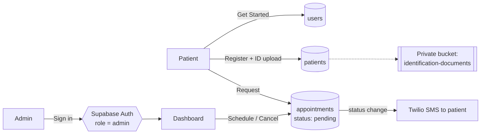

# CarePulse

A patient management app for healthcare providers. Patients register and request appointments in a few steps; admins review, schedule or cancel them from a dashboard, and patients get an SMS when their appointment is confirmed or cancelled.

**Live:** https://carepulse-sigma-red.vercel.app

## Features

- **Patient onboarding** – name, email and phone to get started, then a full registration form (personal details, medical history, insurance, primary physician, identity document upload, consent).
- **Appointment requests** – choose a doctor, date/time and reason; the request is saved as *pending*.
- **Admin dashboard** – stats for scheduled / pending / cancelled appointments and a paginated table to schedule or cancel each request.
- **SMS notifications** – patients are texted via Twilio when an admin schedules or cancels their appointment.
- **Secure by default** – admin access is enforced on the server, the database is locked down with Row Level Security, and identity documents live in a private storage bucket.

## Tech stack

| Area | Technology |
| --- | --- |
| Framework | [Next.js 15](https://nextjs.org/) + React 19 (App Router, Server Components, Server Actions) |
| Language | TypeScript |
| Database, auth & storage | [Supabase](https://supabase.com/) (Postgres, Supabase Auth, Storage) |
| SMS | [Twilio](https://www.twilio.com/) |
| UI | Tailwind CSS, [shadcn/ui](https://ui.shadcn.com/) (Radix UI), TanStack Table |
| Forms & validation | React Hook Form + Zod 4 |
| Testing | Vitest + React Testing Library, local Supabase (Docker) + MSW, Playwright |
| CI | GitHub Actions |
| Hosting | [Vercel](https://vercel.com/) |

## How it works



- All database access happens on the server (Server Components and Server Actions) using the Supabase **service role** key. That key is never sent to the browser.
- Row Level Security is enabled on every table with **no policies**, so the public (anon) key can't read or write any data.
- **Admins** are Supabase Auth users whose `app_metadata.role` is `"admin"`. `app_metadata` can only be changed with the service role, so users can't grant it to themselves. Access is checked in `middleware.ts`, on the admin page, and inside every admin-only action.
- Identity documents are stored in a **private** bucket; only their storage path is saved. Use `createSignedDocumentUrl()` in `lib/supabase.config.ts` to get a short-lived link.

## Getting started

### Prerequisites

- **Node.js 24.x** (pinned in `package.json`)
- A [Supabase](https://supabase.com/dashboard) project
- *(Optional)* A [Twilio](https://console.twilio.com/) account with an SMS-capable phone number

### 1. Install

```bash
git clone https://github.com/ravk24/carepulse.git
cd carepulse
npm install
```

### 2. Configure environment variables

Copy `.env.example` to `.env.local` and fill it in:

```bash
cp .env.example .env.local
```

| Variable | Required | Where to find it |
| --- | --- | --- |
| `NEXT_PUBLIC_SUPABASE_URL` | Yes | Supabase → Project Settings → API |
| `NEXT_PUBLIC_SUPABASE_ANON_KEY` | Yes | Supabase → Project Settings → API (anon / publishable key) |
| `SUPABASE_SERVICE_ROLE_KEY` | Yes | Supabase → Project Settings → API. **Secret: full database access, server-only.** |
| `SUPABASE_BUCKET` | No | Defaults to `identification-documents` |
| `TWILIO_ACCOUNT_SID` | No | Twilio Console |
| `TWILIO_AUTH_TOKEN` | No | Twilio Console |
| `TWILIO_PHONE_NUMBER` | No | A number **owned by your Twilio account**, in E.164 format (e.g. `+15551234567`) |

If the Twilio variables are empty, the app still works and simply skips sending SMS.

### 3. Create the database

In the Supabase dashboard, open **SQL Editor**, paste the contents of [`supabase/schema.sql`](supabase/schema.sql) and run it. It creates the `users`, `patients` and `appointments` tables, enables Row Level Security, and creates the private storage bucket. The script is safe to run more than once.

### 4. Create an admin account

1. Supabase → **Authentication → Users → Add user** (email + password, auto-confirm).
2. Grant the admin role in the SQL Editor:

   ```sql
   update auth.users
   set raw_app_meta_data = coalesce(raw_app_meta_data, '{}'::jsonb) || '{"role":"admin"}'
   where email = 'admin@example.com';
   ```

3. Recommended: **Authentication → Sign In / Providers →** turn off *Allow new users to sign up*. Only admins use Supabase Auth in this app.

### 5. Run

```bash
npm run dev
```

Open http://localhost:3000. To reach the dashboard, click **Admin** in the footer (or go to `/admin`) and sign in with the admin account.

## Scripts

| Command | Description |
| --- | --- |
| `npm run dev` | Start the development server |
| `npm run build` | Create a production build |
| `npm run start` | Serve the production build |
| `npm run lint` | Run ESLint (ESLint 9 flat config, `eslint.config.mjs`) |
| `npm test` | Unit + component tests (fast, no Docker) |
| `npm run test:watch` | Unit + component tests in watch mode |
| `npm run db:test:start` / `db:test:stop` / `db:test:reset` | Start, stop or reset the local Supabase test database (needs Docker) |
| `npm run test:integration` | Server actions against the local Supabase database |
| `npm run test:coverage` | Unit + component + integration with a coverage report and thresholds |
| `npm run test:e2e` | Playwright E2E tests against a production build and the local database |
| `npm run test:e2e:ui` | Playwright in interactive UI mode |

## Testing

153 automated tests across four layers. All tests run against a **local** Supabase in Docker, never the production project, and never send real SMS (Twilio is mocked with MSW).

| Layer | Tests | What it covers |
| --- | --- | --- |
| Unit | 59 | Zod schemas, utilities, constants, Supabase helpers |
| Component | 44 | Patient, Register and Appointment forms, admin login modal, admin table (server actions mocked) |
| Integration | 25 | Real server actions against local Postgres: booking, admin checks, cascade deletes, private uploads, Twilio errors, server-side redirects |
| End-to-end | 25 runs | The full patient journey and admin dashboard in a real browser, plus mobile layout, accessibility (axe), dark-theme contrast and keyboard-only booking |

Coverage: about 94% of lines and 84% of branches. The build fails below the thresholds.

```bash
npm test                 # quick check, no Docker
npm run db:test:start    # once: start local Supabase (Docker Desktop must be running)
npm run test:coverage    # unit + component + integration
npm run test:e2e         # builds the app and runs Playwright
npm run db:test:stop     # when done
```

First-time E2E setup: `npx playwright install chromium`.

**CI:** `.github/workflows/test.yml` runs on every push and pull request to `main` in two jobs:
1. lint, type-check, unit and component tests (about 1 minute);
2. local Supabase, integration tests with coverage, then E2E (about 3 minutes).

Failed E2E runs upload a Playwright report with traces.

## Project structure

```
app/
  page.tsx                      # Home: "Get Started" form (static) + admin sign-in modal
  admin/page.tsx                # Admin dashboard (admins only)
  patients/[userId]/
    register/                   # Full patient registration
    new-appointment/            # Appointment request form
    new-appointment/success/    # Confirmation page
components/
  forms/                        # Patient, Register and Appointment forms
  fields/                       # Lazily loaded date picker / select / checkbox fields
  table/                        # Admin appointments table
  ui/                           # shadcn/ui primitives
  Logo.tsx, DoctorAvatar.tsx, AdminLoginModal.tsx, ...
lib/
  actions/                      # Server Actions: patients, appointments, admin auth
  auth.ts                       # Session helpers: getAdminUser, requireAdminPage, assertAdmin
  supabase.config.ts            # Server-only Supabase client + signed document URLs
  validation.ts                 # Zod schemas
constants/index.ts              # Doctors list, form defaults, ID types
tests/
  unit/ component/              # Vitest (jsdom for components)
  integration/                  # Vitest + local Supabase + MSW
  e2e/                          # Playwright specs, admin login setup
  support/                      # Factories, MSW handlers, test setup
.github/workflows/test.yml      # CI
middleware.ts                   # Protects /admin, refreshes the auth session
supabase/schema.sql             # Database schema, RLS and storage bucket
supabase/config.toml, seed.sql  # Local test database config and seed (admin test user)
```

## Deployment (Vercel)

1. Import the repository into Vercel.
2. Add the environment variables from the table above under **Settings → Environment Variables** (for Production, and Preview if you use it).
3. Set **Settings → Build and Deployment → Node.js Version** to **24.x**. `package.json` also pins `24.x`.
4. Deploy. Every push to `main` deploys automatically.

> Environment variables only apply to deployments started **after** they're added, so redeploy after changing them.

## Troubleshooting

| Symptom | Cause and fix |
| --- | --- |
| Build fails with `supabaseUrl is required` | The Supabase environment variables aren't set in the build environment (e.g. on Vercel). Add them and redeploy. |
| `Could not find the table 'public.users'` (PGRST205), or "Get Started" does nothing | `supabase/schema.sql` hasn't been run on this Supabase project. |
| Vercel: *Node.js Version "20.x" is discontinued* | Set the project's Node.js version to 24.x (or newer) in Vercel settings. |
| Twilio error `21266` (*To and From cannot be the same*) | `TWILIO_PHONE_NUMBER` is set to a personal number. Use a number your Twilio account owns. |
| SMS not delivered on a Twilio **trial** account | Trial accounts can only text verified numbers. For India, enable it under Messaging → Settings → Geo permissions; production delivery to India requires DLT registration. |
| Admin sign-in says *Invalid email or password* for a valid user | The user doesn't have `app_metadata.role = "admin"`. Run the SQL in step 4. |

## Known limitations

- **Patients don't log in.** Patient pages and actions are identified only by IDs in the URL (random UUIDs). Adding patient authentication (e.g. email or SMS one-time codes) and restricting each patient to their own records is the recommended next step before handling real patient data.
- The doctors list is a static constant in `constants/index.ts`.
- The admin dashboard loads at most **1,000 appointments** (Supabase's default row limit), while the counts include all of them. Fine for now; it needs paging before the table grows past that.
